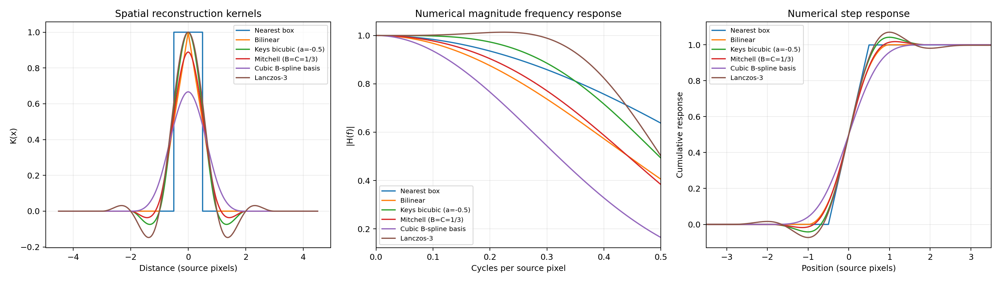

# Сравнение алгоритмов интерполяции цифровых изображений на Python

Исследовательский проект для сравнения классических методов изменения размера изображений. Включает самостоятельную реализацию на NumPy и отдельную базовую реализацию на Pillow.

## Методы

| Метод | Особенность |
|---|---|
| `nearest` | Сохраняет дискретные значения; подходит для масок и пиксельной графики |
| `bilinear` | Быстрый и плавный, но может размывать детали |
| `bicubic` | Кубическая свёртка Keys (`a=-0.5`); резкий результат, возможен звон |
| `mitchell` | Компромисс между резкостью и звоном (`B=C=1/3`) |
| `bspline3` | Кубический B-сплайн с предварительной фильтрацией коэффициентов |
| `lanczos3` | Хорошо сохраняет детали; возможен звон у контрастных границ |
| `area` | Усредняет пиксельные области; особенно полезен при уменьшении |

Самостоятельная реализация (`scratch`) использует NumPy и не вызывает API изменения размера Pillow, OpenCV, SciPy или scikit-image. Pillow применяется для чтения и записи изображений и как отдельный эталон для сравнения. Методы `mitchell` и `bspline3` доступны только в самостоятельной реализации.



## Документация

- [Теоретические основы](docs/theoretical-foundations.md) — дискретизация, частотный анализ, интерполяционные ядра и оценка качества.
- [Реализация с нуля](docs/implementation-from-scratch.md) — формулы, граничные условия и устройство алгоритмов на NumPy.
- [Протокол экспериментов](docs/experiment-protocol.md) — подготовка данных и проведение сравнения.
- [Источники](docs/research-sources.md) — научные публикации и документация библиотек.
- [Краткие заметки](docs/algorithm-notes.md) — соглашения координат, фильтрация и режимы границ.

## Установка

Требуется Python 3.10 или новее.

```bash
git clone https://github.com/pie27182/image-interpolation-study.git
cd image-interpolation-study
python -m venv .venv
source .venv/bin/activate          # Windows: .venv\Scripts\activate
python -m pip install --upgrade pip
python -m pip install -e '.[dev]'
```

Основные зависимости — NumPy и Pillow. Для построения графиков установите дополнительную зависимость: `pip install -e '.[plots]'`.

## Изменение размера изображения

Пример увеличения методом Keys:

```bash
image-interpolation resize input.jpg output.png \
  --width 1200 --height 800 --method bicubic
```

Для Pillow добавьте `--implementation pillow`. Доступные методы самостоятельной реализации: `nearest`, `bilinear`, `bicubic`, `mitchell`, `bspline3`, `lanczos3`, `area`.

Основные дополнительные параметры:

- `--boundary clamp|reflect|wrap|constant` — обработка границ;
- `--coordinate-mode half_pixel|align_corners` — отображение координат;
- `--no-antialias` — отключение расширения фильтра при уменьшении;
- `--keys-a`, `--mitchell-b`, `--mitchell-c` — параметры кубических ядер;
- `--fill-value` — значение за границами при `constant`.

## Сравнительный эксперимент

Сначала создайте синтетические тестовые изображения:

```bash
python examples/generate_test_images.py
```

Затем запустите тест качества и времени выполнения:

```bash
image-interpolation benchmark examples/synthetic_edges.png \
  --scale 2 --degradation lanczos3 --warmup 1 --repeats 5 \
  --output-dir results/synthetic-edges
```

Тест сохраняет восстановленные изображения и `results.csv` с метриками и временем выполнения. По умолчанию изображение низкого разрешения создаётся самостоятельной реализацией; для Pillow используйте `--degradation-implementation pillow`. Повторите сравнение с несколькими фильтрами ухудшения: фильтр реконструкции не следует оценивать только на данных, созданных им самим.

## Тесты

```bash
pytest -q
```

Реализация обрабатывает каналы независимо и автоматически не переводит sRGB в линейное цветовое пространство и не выполняет premultiplied-alpha. Подробности численных соглашений и ограничений приведены в [руководстве реализации](docs/implementation-from-scratch.md) и [теоретическом обзоре](docs/theoretical-foundations.md).

## Лицензия

MIT. См. `LICENSE`.
